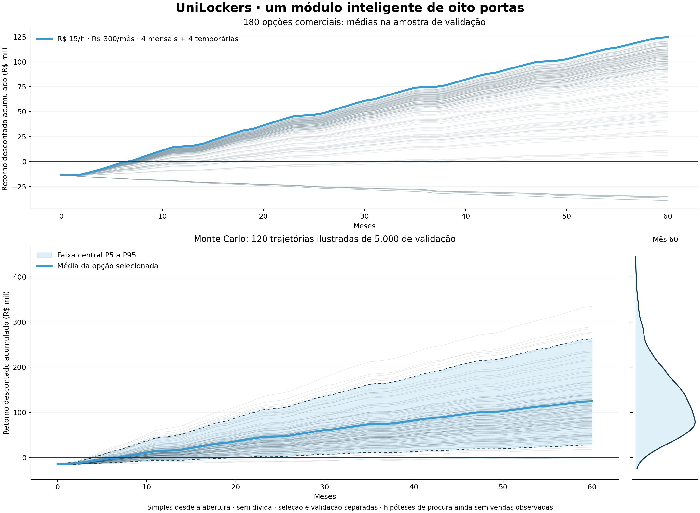

## 3.4. Análise da viabilidade financeira

### 3.4.1. Premissas e investimento inicial

A análise considera a implantação de um armário inteligente de oito compartimentos em uma instituição privada de ensino. O horizonte vai de janeiro de 2027 a dezembro de 2031, totalizando sessenta meses. A empresa é organizada como sociedade limitada com sócio único, com sede inicial em Porto Alegre. Para fins dos cálculos, adota-se a hipótese de locação pura de bens móveis sob a CNAE 7729-2/02, conforme a proposta da seção 3.1. A validade desse tratamento depende do contrato e da operação efetivamente realizados.

O equipamento tem preço bruto de referência de R$ 1.700,00, dentro do intervalo de R$ 1.500,00 a R$ 2.500,00 informado para o estudo. Esse preço antecede frete e tributos. A captura comercial do fornecedor menciona recursos de acesso remoto e integração, mas a configuração contratada, as licenças e a compatibilidade com pagamentos brasileiros ainda precisam ser confirmadas. A provisão de importação corresponde a uma estimativa orçamentária agregada; a definição da NCM e do tratamento aduaneiro poderá alterar o desembolso.

| Componente | Valor |
|---|---|
| Equipamento de oito portas, referência bruta | R$ 1.700,00 |
| Frete e seguro internacional, estimativa | R$ 1.500,00 |
| Provisão agregada de importação: 70% de R$ 3.200 | R$ 2.240,00 |
| Desembaraço e transporte local | R$ 900,00 |
| Integração inicial | R$ 1.200,00 |
| Formalização e implantação | R$ 1.000,00 |
| Contingência de 10% | R$ 854,00 |
| Implantação | R$ 9.394,00 |
| Reserva de três meses de custos fixos | R$ 3.096,00 |
| Necessidade inicial total | R$ 12.490,00 |

Fonte: elaboração própria com os parâmetros do projeto. Valores estimados, sem proposta comercial aceita.

A contabilidade no Simples foi orçada em R$ 592,00 mensais, ponto médio do intervalo de R$ 486,00 a R$ 698,00 citado na seção 3.1. Para o Lucro Presumido, manteve-se a referência de R$ 1.122,00; para o Lucro Real, adotou-se R$ 1.500,00 como hipótese, com variação entre R$ 1.200,00 e R$ 2.000,00 na simulação. O custo de R$ 800,00 no Simples com IBS/CBS fora do DAS também é uma hipótese, por exigir apuração adicional.

| Componente mensal | Valor |
|---|---|
| Limpeza terceirizada | R$ 200,00 |
| Manutenção terceirizada | R$ 80,00 |
| Deslocamentos | R$ 30,00 |
| Plataforma | R$ 80,00 |
| Administração | R$ 50,00 |
| Contabilidade no Simples | R$ 592,00 |
| Custos fixos de caixa | R$ 1.032,00 |

Energia, internet, instalação e adequações são fornecidas pela instituição, conforme a configuração do projeto. O repasse institucional continua indefinido e foi representado por 10% da receita no cenário central, com variação de zero a 20% nas simulações. Somam-se 3% para recebimentos e R$ 0,75 por sessão temporária. Foi mantida uma perda esperada de R$ 100,00 por ano por módulo para ocorrências, além de reposição eletrônica de R$ 800,00 a preços iniciais no mês 37. Essas provisões não correspondem a seguro contratado nem limitam eventual responsabilidade por danos.

O cenário de caixa pressupõe que o sócio não receba retiradas durante o período. O valor de seu trabalho é examinado separadamente, utilizando as 26 horas mensais e a referência de R$ 20,00 por hora apresentadas na seção técnica. Assim, o resultado financeiro pode ser comparado com uma avaliação que reconhece R$ 520,00 mensais de trabalho, mesmo sem pagamento. A depreciação física gerencial de 5% ao ano foi preservada para o módulo inteligente; a integração inicial é amortizada em sessenta meses. Esses valores afetam a comparação contábil no Lucro Real, mas a depreciação não representa saída de caixa mensal.

### 3.4.2. Receita, preços e ponto de equilíbrio

O horário considerado é de segunda a sábado, das 7h30 às 21h30. Uma sessão temporária ocupa três horas, acrescidas de quinze minutos para troca, permitindo até quatro janelas por dia e por porta. O calendário utiliza os dias de segunda a sábado de cada ano, sem dedução específica de feriados ou bloqueios ainda não informados. A disponibilidade técnica foi fixada em 98%, e as férias foram representadas por fatores sazonais de procura.

Foram comparadas 180 combinações: tarifas de R$ 5,00, R$ 8,00, R$ 10,00, R$ 12,00 e R$ 15,00 por hora; mensalidades de R$ 120,00, R$ 180,00, R$ 240,00 e R$ 300,00; e as nove divisões possíveis das oito portas entre as duas modalidades. Na amostra de seleção, a combinação de maior VPL médio foi R$ 15,00 por hora, R$ 300,00 por mês e quatro portas para cada modalidade. A escolha se refere à grade avaliada. Como os preços vencedores estão no limite superior da grade, a pesquisa ainda não identifica o preço ótimo fora desses intervalos.

A procura utiliza um ponto com público do porte da PUCRS, com 11.969 matrículas presenciais, e a proporção regional de 34,4% de estudantes da rede privada com renda per capita superior a dois salários mínimos, ambas informadas na análise de mercado. O alcance de 20% desse grupo, a conversão mensal de 0,5%, a conversão temporária de 6% e a frequência de quatro sessões mensais são hipóteses. Também são estimadas a elasticidade-preço, a maturação inicial e a expansão real de 3% ao ano da procura. Nenhuma dessas proporções foi medida por vendas no campus. Os dados de renda e curso, provenientes de bases distintas, não demonstram a interseção exata dos dois grupos.

No cenário central, o primeiro ano apresenta 21,4 compartimentos-mês e 972,3 sessões, resultando em receita de R$ 50.167,05. A média mensal corresponde a 1,8 mensalistas e 81,0 sessões. As quantidades fracionárias representam valores esperados, e não contratos individuais.

| Mensalistas ativos a R$ 300 | Sessões de 3 h/mês para equilíbrio operacional³ |
|---|---|
| 0 | 28,4 |
| 1 | 21,6 |
| 2 | 14,8 |
| 3 | 8,0 |
| 4 | 1,2 |

³ Mês de referência de 2027, sem dívida, sem retirada, antes de recuperar o investimento. Inclui perda esperada de R$ 100,00 ao ano. Uma sessão de três horas custa R$ 45,00. Quantidades devem ser arredondadas para cima no planejamento de vendas. Fonte: elaboração própria.

O ponto de equilíbrio operacional cobre os desembolsos do mês. A recuperação do investimento com a taxa de retorno exige receita adicional. No fluxo de sessenta meses, mantendo os preços e a trajetória de custos, a procura pode cair até aproximadamente 33,90% do cenário central antes de o VPL atingir zero. Nesse limite, a receita do primeiro ano é de R$ 17.179,16, com média de 0,6 mensalistas e 27,6 sessões por mês. Trata-se de uma redução proporcional da procura antes da limitação de capacidade, sem alterar o repasse e os demais custos.

### 3.4.3. Tributação e comparação entre regimes

Na hipótese de locação pura de bens móveis, a apuração do Simples considera o Anexo III com exclusão da parcela de ISS. Foram aplicadas as partilhas previstas para cada ano da transição. Na primeira faixa de receita, a carga efetiva adotada é de 3,99% em 2027 e 2028, 4,191% em 2029, 4,392% em 2030 e 4,593% em 2031. A alíquota efetiva também depende da receita acumulada em doze meses e da parcela a deduzir. A incidência de serviços de guarda ou custódia exigiria outra análise da operação e da segregação das receitas. [LC 123/2006](https://www.planalto.gov.br/ccivil_03/leis/lcp/lcp123.htm), [partilhas alteradas pela LC 227/2026](https://legis.senado.gov.br/norma/40180341/publicacao/40181117).

Fora do Simples integral, os cenários utilizam IBS/CBS por fora da base, com preços finais ao estudante mantidos iguais. Portanto, uma alíquota de consumo de r corresponde a r/(1+r) do recebimento. Para 2027 e 2028, utilizou-se CBS de 11,2% e IBS de 0,1%, considerando a referência de CBS de 11,3% calculada pelo TCU e o ajuste transitório. Para 2029, 2030 e 2031, os totais de 13,2%, 15% e 16,9% foram mantidos como hipóteses de planejamento extraídas da seção legal. A definição das alíquotas futuras permanece sujeita aos atos aplicáveis. [TCU, cálculo de referência](https://sites.tcu.gov.br/reforma-tributaria/visao-cbs-2027.html), [LC 214/2025](https://www.planalto.gov.br/ccivil_03/leis/lcp/lcp214.htm).

Não foi reconhecido crédito de importação sem documento que identifique o tributo recuperável. O aproveitamento de créditos pode melhorar os regimes regulares, mas sua entrada em caixa depende da documentação, da apuração e da compensação ou do ressarcimento cabível. Na sensibilidade com crédito inicial identificado de R$ 1.000,00, o VPL determinístico do Lucro Real por cinco anos chega a R$ 39.222,28, ainda abaixo do Simples nas demais premissas adotadas.

| Regime | VPL determinístico | VPL médio simulado | VPL positivo na validação |
|---|---|---|---|
| Simples desde a abertura | R$ 113.663,45 | R$ 124.690,85 | 99,32% |
| Real em 2027 e Simples de 2028 em diante | R$ 95.347,83 | R$ 104.427,89 | 97,54% |
| Real por dois anos e depois Simples | R$ 79.684,19 | R$ 87.328,35 | 95,10% |
| Real por três anos e depois Simples | R$ 65.002,18 | R$ 71.317,37 | 91,38% |
| Real por quatro anos e depois Simples | R$ 51.291,20 | R$ 56.379,49 | 86,18% |
| Lucro Real nos cinco anos | R$ 38.479,34 | R$ 42.445,36 | 79,28% |
| Lucro Presumido nos cinco anos | R$ 58.122,09 | R$ 64.073,14 | 87,52% |
| Simples com IBS/CBS no regime regular | R$ 81.220,07 | R$ 86.571,35 | 95,44% |

Fonte: elaboração própria. Mesmos preços e procura, um módulo e ausência de dívida. A reserva inicial muda com o custo contábil de cada regime. Simulações condicionais às distribuições adotadas.

Nos períodos de Lucro Real, o modelo apura IRPJ e CSLL por trimestre e controla a compensação de prejuízos anteriores até 30% do resultado positivo ajustado. O estoque não expira automaticamente após cinco anos. A passagem ao Simples ocorre apenas em marcos de ano-calendário e não permite usar esse estoque para reduzir o DAS. A apuração foi simplificada, sem diferenças específicas entre as bases de IRPJ e CSLL. Os tributos são reservados no período de apuração, sem reproduzir cada data de vencimento. [Receita Federal, compensação de prejuízos](https://www.gov.br/receitafederal/pt-br/centrais-de-conteudo/publicacoes/perguntas-e-respostas/ecf/perguntas-e-respostas-da-pessoa-juridica-2025.pdf).

O Simples desde a abertura apresentou o maior VPL médio na amostra de seleção. Se a empresa iniciar no Lucro Real, a primeira migração anual testada, em janeiro de 2028, foi a alternativa mais favorável entre as sequências que começam nesse regime. O prejuízo inicial, por si só, não justifica o Lucro Real: a economia tributária precisa superar o custo contábil adicional. A decisão deverá ser refeita se houver investimentos maiores, créditos comprovados ou mudança relevante na composição dos clientes.

### 3.4.4. Fluxo de caixa e recuperação do capital

Adota-se taxa mínima de atratividade de 12% real ao ano e inflação de 4% no cenário central, resultando em desconto nominal de 16,48% ao ano. Preços e custos são reajustados anualmente pela inflação. O VPL deduz a implantação e a reserva inicial e desconta os fluxos mensais. Não se acrescentam venda do equipamento nem liberação da reserva no fim do quinto ano.

| Ano | Receita bruta | Custos fixos | Custos variáveis¹ | DAS | Reposição | Caixa gerado² |
|---|---|---|---|---|---|---|
| 2027 | R$ 50.167,05 | R$ 12.384,00 | R$ 7.350,91 | R$ 2.001,67 | R$ 0,00 | R$ 28.430,47 |
| 2028 | R$ 59.912,64 | R$ 12.879,36 | R$ 8.765,02 | R$ 2.390,51 | R$ 0,00 | R$ 35.877,75 |
| 2029 | R$ 64.041,25 | R$ 13.394,53 | R$ 9.366,45 | R$ 2.683,97 | R$ 0,00 | R$ 38.596,30 |
| 2030 | R$ 68.437,70 | R$ 13.930,32 | R$ 10.006,85 | R$ 3.005,78 | R$ 899,89 | R$ 40.594,87 |
| 2031 | R$ 73.079,57 | R$ 14.487,53 | R$ 10.682,90 | R$ 3.356,54 | R$ 0,00 | R$ 44.552,60 |

¹ Repasse institucional, recebimentos, custo das sessões e provisão por ocorrências. ² Após tributos e reposições, sem dívida e sem retirada do sócio. A reposição do mês 37 aparece em 2030. Fonte: elaboração própria.

O VPL determinístico é de R$ 113.663,45. O payback simples e o descontado ocorrem no mês 7, considerando o primeiro cruzamento que permanece não negativo até o fim do horizonte. O prazo inferior a sessenta meses atende à meta do projeto sob essas premissas. A retenção do caixa para reinvestimento não corresponde a dividendos já recebidos pelo sócio; a recuperação calculada mede a geração de recursos disponíveis pela operação.

### 3.4.5. Risco e simulação de Monte Carlo

Foram geradas 10.000 trajetórias mensais, com semente 20261116. As primeiras 5.000 serviram para selecionar preços e distribuição das portas; as outras 5.000 avaliaram a alternativa escolhida. A opção comercial é fixada antes de observar a amostra de validação. O gráfico apresenta 120 trajetórias dessa amostra, a média, os percentis 5 e 95 e a distribuição do resultado no mês 60.

As simulações variam preço de compra, frete, custos operacionais, honorários, repasse, inflação, conversão, frequência, elasticidade e ocorrências. A procura temporária é limitada pelas janelas disponíveis, e a mensal pelas portas reservadas. As combinações são comparadas com os mesmos sorteios de procura e custos, reduzindo a influência de diferenças aleatórias na escolha. As distribuições e seus intervalos constam da memória de cálculo.

Na validação, o VPL médio é de R$ 124.690,85, com mediana de R$ 113.861,79. O percentil 10 é de R$ 41.384,71, e o percentil 90, de R$ 223.261,75. Em 99,32% das trajetórias o VPL é não negativo; em 0,06% ocorre falta de caixa mesmo com a reserva inicial. Ao valorar o trabalho do sócio em R$ 520,00 mensais, reajustados pela inflação, o VPL médio econômico é de R$ 101.512,40, positivo em 95,82% da amostra. Esse custo imputado não foi deduzido como despesa fiscal nem tratado como retirada efetiva.

Esses percentuais são frequências dentro do modelo. A faixa central do gráfico representa dispersão simulada, e não intervalo de confiança de vendas observadas. Uma procura inferior aos limites assumidos pode produzir perdas maiores. No teste determinístico com metade da procura central, o VPL cai para R$ 28.147,97; com apenas um quarto, chega a R$ -15.608,95 e há insuficiência de caixa. A viabilidade comercial permanece dependente da procura e da disposição a pagar que forem verificadas no piloto.

### 3.4.6. Financiamento e expansão

Foram recalculadas participações de financiamento de 100%, 75%, 50%, 10% e zero. A referência de custo mantém TR mensal de 0,1693% acrescida de 6,068% ao ano, prazo de sessenta meses e doze meses de carência de principal, com juros pagos durante a carência e amortização SAC nos 48 meses seguintes. A composição acrescenta R$ 500,00 de encargo inicial, 2% sobre o principal e R$ 500,00 anuais enquanto existir saldo. Esses encargos e prazos são hipóteses de cálculo, não uma proposta de uma única instituição. O custo efetivo estimado foi obtido pelos fluxos de recebimento líquido e pagamentos, sem equivaler a CET bancário contratado.

| Parcela financiada | Aporte próprio | Principal com encargos | Primeira parcela após carência | Custo efetivo estimado a.a. | Falta de caixa na validação |
|---|---|---|---|---|---|
| 100,00% | R$ 0,00 | R$ 13.255,10 | R$ 363,93 | 16,16% | 0,72% |
| 75,00% | R$ 3.122,50 | R$ 10.068,88 | R$ 276,45 | 18,46% | 0,46% |
| 50,00% | R$ 6.245,00 | R$ 6.882,65 | R$ 188,97 | 22,98% | 0,30% |
| 10,00% | R$ 11.241,00 | R$ 1.784,69 | R$ 49,00 | 71,89% | 0,20% |
| 0,00% | R$ 12.490,00 | R$ 0,00 | R$ 0,00 | Não se aplica | 0,06% |

O custo de encargos fixos pesa mais nos empréstimos pequenos, o que explica a taxa efetiva elevada quando se financia somente 10% do investimento. Também foi mantido o estresse de 4% ao mês por 36 meses: com 100% financiado, a primeira parcela fica em R$ 898,40 e a falta de caixa ocorre em 8,88% da validação. A taxa de 4% ao mês é um parâmetro de estresse, sem oferta de banco atribuída.

Com 100% de financiamento, o aporte inicial próprio é zero, mas permanecem juros, amortizações e risco de necessidade de recursos adicionais. Nessa configuração, o payback do aporte próprio não é definido. A comparação da viabilidade do equipamento utiliza o fluxo do projeto sem dívida, enquanto a escolha do financiamento considera os encargos e a capacidade de pagamento.

O BRDE Jovem Empreendedor é compatível com o perfil etário informado e menciona equipamentos nacionais e importados. A taxa depende da análise de crédito, e o capital de giro tem limite vinculado à receita do exercício anterior, restringindo a hipótese de financiar toda a reserva para uma empresa sem faturamento. Finep Inovacred e as operações de inovação do Badesul dependem de enquadramento do projeto e aprovação pelo agente. A taxa pública da Finep utilizada como referência não comprova que a simples compra do armário seja financiável. O Cartão BNDES exige itens credenciados e, em regra, fabricação nacional, portanto não foi presumido como fonte para importar este equipamento. Nenhum crédito foi considerado aprovado. [BRDE](https://brde.com.br/linha-financiamento/jovem-empreendedor/), [Finep](https://www.finep.gov.br/credito-operado-por-agentes), [Badesul](https://www.badesul.com.br/produtos/inovacao), [Cartão BNDES](https://www.cartaobndes.gov.br/cartaobndes/PaginasCartao/FAQ.ASP?Acao=R&Cod=91%2C91&T=2).

A expansão considera um módulo em cada localização. Foram mantidas as matrículas da análise de mercado para distinguir os dois campi da Unisinos: 2.147 em Porto Alegre e 7.179 em São Leopoldo. Esses números servem apenas como escala de público; não comprovam fluxo no ponto de instalação nem parceria com as instituições.

| Configuração ilustrativa | Investimento total | Receita no primeiro ano | VPL determinístico |
|---|---|---|---|
| PUCRS de referência | R$ 12.490,00 | R$ 50.167,05 | R$ 113.663,45 |
| PUCRS + Unisinos Porto Alegre | R$ 20.724,00 | R$ 59.259,75 | R$ 122.151,49 |
| PUCRS + Unisinos São Leopoldo | R$ 20.724,00 | R$ 80.504,89 | R$ 195.655,89 |

Fonte: elaboração própria. Mesmos preços e divisão de portas, ambos os módulos desde o início de 2027, sem dívida. Administração, plataforma e contabilidade são compartilhadas; limpeza, manutenção, transporte e integração crescem por módulo. A economia no desembaraço depende de compra conjunta; não foi assumido desconto no equipamento.

Na simulação de dois pontos, a procura local é sorteada separadamente, com calendário e fatores macroeconômicos comuns. O segundo módulo no campus de Porto Alegre acrescenta VPL médio de R$ 9.643,87, mas seu percentil 10 incremental é de R$ -6.466,80. Há 27,02% de resultados incrementais negativos nesse teste. Para São Leopoldo, o acréscimo médio é de R$ 88.804,01. Uma correlação maior entre as quedas de procura pode reduzir o benefício de diversificação e precisa ser avaliada após o piloto.

A compra do segundo módulo depende, portanto, do ponto escolhido e do custo para atendê-lo. Se o novo campus também exigir 26 horas mensais de trabalho, esse custo deverá ser acrescido antes da decisão. O cenário central sustenta a implantação de um módulo inteligente, com retorno superior à meta adotada, condicionado à confirmação do custo entregue, da integração, do contrato com a instituição e das primeiras vendas. A expansão deve ocorrer após medir a procura no segundo local e demonstrar contribuição incremental suficiente para seus custos.

# Revisão de coerência da UniLockers

Referência: 15 de novembro de 2026. Documento recebido: 3ª Avaliação de Botas.md. Cenário principal confirmado: inteligente de oito portas.

## O que muda nos resultados

O investimento central é R$ 12.490,00, incluindo R$ 3.096,00 de reserva. A receita central do primeiro ano permanece igual à do modelo anterior, R$ 50.167,05, permitindo identificar o efeito das novas despesas e do enquadramento fiscal. O cenário principal passa a comparar o projeto sem dívida no Simples desde a abertura. A referência antiga de um ano no Lucro Real permanece como alternativa, com VPL determinístico de R$ 95.347,83.

## Ajustes necessários no trabalho

| Local | Divergência | Tratamento na revisão |
|---|---|---|
| 1.4.2 e 1.7 | Fechamentos analógicos descritos com envio remoto do segredo | Inteligente de oito portas como objeto principal; liberação e expiração remotas dependem de confirmação técnica. |
| 1.6 | R$ 50 mensal, R$ 150 semestral e R$ 250 anual | Valores rejeitados pelo autor; substituídos pela grade, sem plano anual de preço arbitrário. |
| 1.10 | Investimento de R$ 500 a R$ 600 e DAS MEI | Implantação de R$ 9.394,00, sociedade limitada com sócio único e contabilidade por regime. |
| 2.2 e 3.1 | CNAE 5211-7/02 tratada como principal na oferta, 7729-2/02 na abertura | 7729-2/02 como hipótese jurídica principal; RAIS de guarda-móveis permanece como setor correlato, sem apresentar os 38 estabelecimentos como concorrentes comprovados. |
| 2.1 | Produto de percentuais de renda e curso tratado como máximo | Conservadas as bases e os números; qualificado como exercício sob hipótese de independência, sem observar a interseção nas duas bases. |
| 2.4 | Seis portas, quatro assinaturas mais duas temporárias, e capacidade de seis assinaturas simultâneas | Oito portas; grade completa de alocações. Quatro mensais mais quatro temporárias no caso selecionado. Capacidade e produção ficam separadas. |
| 2.4 | 22 dias, duas janelas de quatro horas e 10% de depreciação para o analógico | Horário informado pelo autor, quatro janelas de três horas e depreciação gerencial de 5% para o inteligente. |
| 2.4.9 | Expansão automática para 2, 4, 6 e 8 armários | Teste de um e dois módulos em locais distintos; sem multiplicar o faturamento do primeiro campus. |
| 3.1 | Cinco anos como prazo geral de compensação de prejuízo | Sem expiração geral de cinco anos, com trava de 30% do lucro positivo ajustado e documentação fiscal. |
| 3.1 | Alíquota inicial integral de 6% para locação pura | Dedução da parcela de ISS e transição anual; primeiro patamar de 3,99% em 2027/28. |
| 3.1 | Referências futuras de IBS/CBS apresentadas como definitivas | Separadas de regras promulgadas; 11,3% da CBS é referência calculada pelo TCU, com atos de fixação ainda a acompanhar na data da pesquisa. |
| 3.1 | Cliente PJ do Simples tradicional não pode se creditar | Crédito do adquirente regular pode ser limitado ao montante recolhido no Simples; não equivale à vedação absoluta. |
| 3.1 | CNAE ou contrato eliminaria toda responsabilidade pelos pertences | Afastada a exoneração geral. Contrato de locação e responsabilidades por falhas devem refletir a operação e o CDC. |
| 3.1 | SLU exigiria conversão em outra natureza ao admitir sócio | Limitada pode ter um ou mais sócios, mediante alteração contratual. Proteção patrimonial não é absoluta em hipóteses legais. |
| 3.1 | RAT grave de 3% aplicado automaticamente | Enquadramento e incidência devem ser apurados; modelo sem empregados e sem retirada não adiciona folha inexistente. |
| Monte Carlo | Contabilidade de R$ 200 no Simples e consumo líquido genérico de 15% no Real | Honorários do arquivo e apuração segregada de consumo/renda; créditos não comprovados ficam em zero. |
| Financiamento | Condições de instituições distintas poderiam parecer uma oferta única | Referência composta e estresse são explicitados; nenhum empréstimo considerado aprovado. |

## Limites que mudam a decisão

O alto percentual de VPL positivo, 99,32%, depende de priors sem calibração por vendas. A procura central, o preço de três horas (R$ 45,00), a mensalidade e a frequência devem ser testados no ponto. A alternativa está na borda superior da grade de preços. A incerteza de especificação, frete e classificação aduaneira exige cotação do custo entregue.

Um segundo módulo na Unisinos de Porto Alegre tem resultado incremental menor e pode ter VPL negativo; o campus de São Leopoldo é outra hipótese, com população diferente. As matrículas são dados de escala do estudo, não fluxo no corredor ou autorização para instalação. A demanda local é independente no sorteio, mas calendário e fatores macroeconômicos são comuns. A correlação de adesão entre campi não foi estimada.

O VPL remunera os recursos investidos na atividade. Com dívida, o saldo disponível pertence ao fluxo do capital próprio; não se deve atribuir sua rentabilidade à qualidade do equipamento nem escolher alavancagem apenas por dividir por um aporte pequeno. Com aporte próprio zero, o payback desse aporte não existe.

O modelo acompanha a formação de uma reserva, admite meses negativos e sinaliza falta de caixa. Não presume uma linha adicional de resgate nem reduz a operação automaticamente em trajetórias deficitárias. O indicador de VPL positivo sem falta de caixa deve ser lido junto do VPL isolado.

## Fontes verificadas

- [IBGE, notas explicativas CNAE](https://ftp.ibge.gov.br/Informacoes_Gerais_e_Referencia/Classificacoes/CNAE/cnae2_2/cnae2_2_subclasses_20150609.pdf): descrição do código, sem decidir por si só a natureza da relação efetiva.
- [STF, SV 31 e contratos mistos](https://portal.stf.jus.br/jurisprudencia/sumariosumulas.asp?base=26&sumula=1286).
- [Receita Federal, compensação de prejuízos](https://www.gov.br/receitafederal/pt-br/centrais-de-conteudo/publicacoes/perguntas-e-respostas/ecf/perguntas-e-respostas-da-pessoa-juridica-2025.pdf).
- [Senado, partilhas do Anexo III](https://legis.senado.gov.br/norma/40180341/publicacao/40181117).
- [TCU, cálculo CBS 2027](https://sites.tcu.gov.br/reforma-tributaria/visao-cbs-2027.html) e [Senado, debate ainda agendado em 13/11/2026](https://www12.senado.leg.br/noticias/materias/2026/11/13/cae-ministro-da-fazenda-debate-aliquota-da-cbs-na-terca-feira).
- [Decreto 12.955/2026, crédito do adquirente regular de fornecedor do Simples](https://www2.camara.leg.br/legin/fed/decret/2026/decreto-12955-29-abril-2026-799019-publicacaooriginal-179077-pe.html).
- [NFS-e nacional, orientações de 06/11/2026](https://www.gov.br/nfse/pt-br/perguntas-frequentes/perguntas-frequentes-nfs-e-v1-3-20261106.pdf/%40%40download/file): novos fatos geradores e código de locação. A dispensa genérica de certificado e a disponibilidade de cada emissor não foram presumidas.
- [Receita, SC Cosit 120/2016](https://normas.receita.fazenda.gov.br/sijut2consulta/anexoOutros.action?idArquivoBinario=41018): diferencia ausência de pagamentos de remuneração disfarçada em distribuição de lucro.
- [BRDE Jovem Empreendedor](https://brde.com.br/linha-financiamento/jovem-empreendedor/), [Finep](https://www.finep.gov.br/credito-operado-por-agentes), [Badesul](https://www.badesul.com.br/produtos/inovacao), [Cartão BNDES](https://www.cartaobndes.gov.br/cartaobndes/PaginasCartao/FAQ.ASP?Acao=R&Cod=91%2C91&T=2).

## Premissas de Monte Carlo

Semente 20261116; 5.000 trajetórias de seleção e 5.000 de validação. Compra uniforme R$ 1.500–2.500. Triangulares: frete (1.000; 1.500; 2.500), multiplicador de outros custos (0,85; 1; 1,3), contabilidade Simples (486; 592; 698), Real (1.200; 1.500; 2.000), Presumido (900; 1.122; 1.500), híbrido (698; 800; 1.122), alcance (10%; 20%; 35%), conversão mensal (0,2%; 0,5%; 0,9%), conversão temporária (3%; 6%; 10%), frequência (2; 4; 6), elasticidade (0,3; 0,9; 1,8), repasse (0%; 10%; 20%), inflação (3%; 4%; 6%) e deslocamento da alíquota de consumo regular (-2; 0; +3 pontos percentuais). TR mensal varia (0,08%; 0,1693%; 0,35%). O deslocamento tributário é sensibilidade, não regra legal.

Procura: Poisson com choque mensal lognormal de média 1 e desvio logarítmico 0,15. Conversões por modalidade e elasticidades são independentes por hipótese. As tarifas maiores usam thinning binomial da procura menor. As janelas têm disponibilidade de 98%; ocorrências seguem Poisson de 0,1 por ano e custo de R$ 1.000. Não há confirmação empírica dessas distribuições. O modelo não inclui aluguel fixo adicional ao repasse. Se o contrato exigir ambos, refazer o orçamento.

Conferência: reconciliação receita-custos-tributos-caixa, empréstimo-principal-saldo, fluxos descontados-VPL, limite físico, separação seleção/validação, taxa anual do Simples, cenário sem clientes e compensação de perdas sem imposto fictício. Os arquivos anteriores permanecem históricos e não devem ser combinados com esta revisão.

A numeração 3.4 foi mantida por solicitação do autor. O arquivo recebido termina a Parte 3 em 3.1; as seções 3.2 e 3.3 não foram inventadas. O sumário teve os números de página antigos retirados, pois a nova paginação dependerá da diagramação final.
